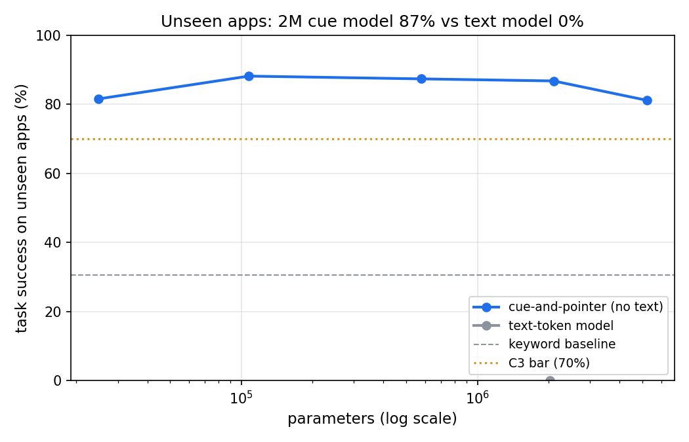

# 01 · Pocket actions: a tiny model that operates apps without language

**Goal:** finish multi-step tasks in phone apps the model has never seen, with 2M parameters or less (8 MB), trained in about 5 minutes (10 at most) on one GPU.
**Verdict:** INCONCLUSIVE (2/5 criteria). ✨ INTRIGUING: a 25K-parameter model (100 KB) gets 82% on apps it has never seen, about the same as the 2M model (87%) and far above keyword matching (31%). It falls apart on long tasks (5%). A same-size model that reads and writes text completes 0%.
**Details:** [results](results/results.md) · [explainer](EXPLAINER.md) · [plan](https://claude.ai/artifact/41b5MpqiRaq4BaRwsBHPch)

| # | Criterion | Threshold | Result |
| --- | --- | --- | --- |
| C1 | Budget: kept models, GPU training, eval RAM, CPU time per decision | ≤ 50 MB, ≤ 10 min, ≤ 2 GB, ≤ 10 ms | FAIL: 70 MB of fp32 checkpoints; 4.6 min, 0.07 GB and 3.5-6.8 ms pass |
| C2 | In-distribution success (2M model, 3 seeds) | ≥ 90% | FAIL: 84.9% ± 1.3% |
| C3 | Success on unseen apps (core) | ≥ 70% and ≥ keyword + 25 pts | PASS: 86.8% ± 1.4% (keyword 30.6%) |
| C4 | Success on tasks with twice the sub-goals | ≥ 60% | FAIL: 5.3% ± 0.5% |
| C5 | Cue model vs same-size text model, unseen apps | ≥ +15 pts | PASS: +86.8 pts (text model 0.0%; [diagnostic](results/diag_text.json) rules out an eval bug) |
| NC | Negative control: the instruction swapped for another task's | must stay < 15% | 0.0%, as it should |



## What I found that the plan didn't predict

- **Size barely matters here.** 25K, 100K, 500K and 2M parameters all land at 82-88% on unseen apps. The 5M model was slightly worse, because 25 seconds of training was too little for it. The rules of this world fit in about 100 KB.
- **Long tasks break.** The likely cause: each cue carries an absolute clause number. Training instructions have at most 3 sub-goals, so the higher clause numbers that long instructions reach are rarely or never trained. A relative signal ("the first unfinished clause") would probably fix it, and that's the obvious follow-up. Not yet verified.
- **New wording hurts, as designed.** Unseen joiners ("after that", "next") stop the parser from splitting clauses, and success drops to about 28%.
- **The text model isn't broken, it just can't spell.** A diagnostic shows it gets the verb right but misspells names it has never seen ("OPEN tezuba" comes out as "OPEN ba"). Only about 18% of its single steps are exactly right, and every task needs all of them. Pointing at a screen element sidesteps spelling entirely.
- **int8 costs nothing.** cue-2m at int8 (about 2 MB) scores the same as fp32. Storing the checkpoints as fp16 or int8 would have passed C1's size limit, but the threshold was measured on what was actually saved.

## The idea

PocketOS is a simulated phone whose apps, folders and file names are generated fresh for every task, so nothing can be memorised. The model reads the instruction as loose cue words (each tagged with its clause and its role, for example "location" or "destination") and sees the screen as a list of elements. Every step, it points at one element and one action. It never writes text. It is compared against a same-size model that reads and writes plain text, a keyword-matching baseline (27% on unseen apps) and a random agent (1%).

Prior work: [FunctionGemma](https://blog.google/technology/developers/functiongemma/) (270M, 85% on Mobile Actions), [Octopus v2](https://arxiv.org/abs/2404.01744), [TinyAgent](https://arxiv.org/abs/2409.00608), [Tiny Recursive Model](https://arxiv.org/abs/2510.04871), [BabyAI](https://arxiv.org/abs/1810.08272).

## Run it

```bash
python train.py --smoke   # 1-2 min end-to-end check (NVIDIA GPU)
python train.py           # full sweep: about 5 min of GPU training (hard cap 5.5), then GPU evaluation
python run.py             # PASS/FAIL table, plots, results/ (CPU, never trains)
python -m pytest -q
```

Training needs `requirements-gpu.txt` (PyTorch with CUDA). Evaluation, tests and CI use only NumPy.

## Deviations from SOP

- Training needs a GPU, so `run.py` judges the GPU evaluation in `results/eval.json` and re-checks a sample of it on CPU. It doesn't recompute every number.
- Obi cut the training budget to about 5 minutes (2026-11-04), so the recursive-2M, no-match-bits, demonstration-count and 500K text-model runs were dropped before any training. The blind-prompt, random-weights, int8 and clutter controls remain, and they are evaluation-only.
- The cue parser knows only the training-time joiner words ("then", "and"). The "new wording" split uses joiners it has never seen.

## Files

`pocketos.py` simulator and expert · `features.py` cue and text encodings · `model_np.py` NumPy inference · `model_torch.py` training models · `rollout.py` demonstrations and DAgger · `train.py` GPU training and evaluation · `criteria.py` pre-registered criteria · `run.py` verdict
