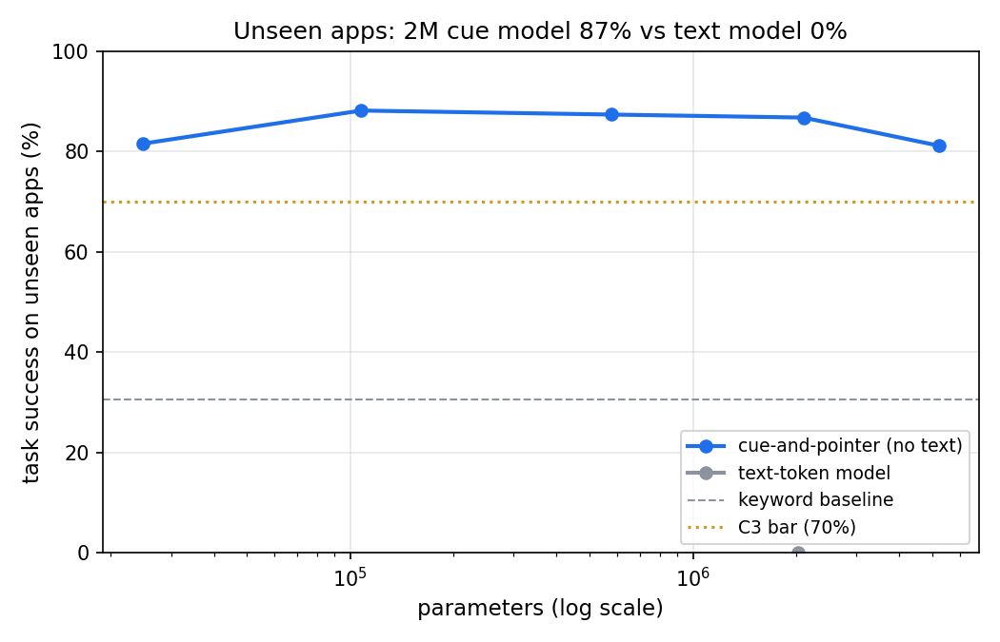
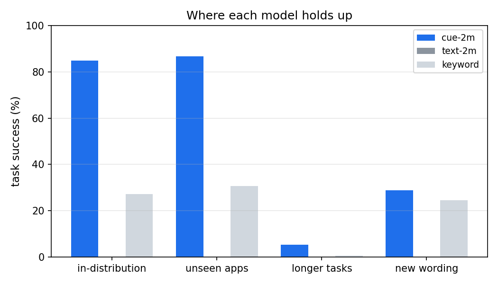

# Results: experiment 01

seed 0 � quick False � GPU NVIDIA GeForce RTX 4080 SUPER � torch 2.5.1+cu124 � 500 tasks per split � GPU training 4.57 min � python 3.12.10 � numpy 2.1.3 � peak RAM 0.07 GB � run.py 63 s

**Verdict: INCONCLUSIVE** (2/5 criteria)

| # | Criterion | Value | Threshold | Result |
| --- | --- | --- | --- | --- |
| C1 | Budget: kept models, GPU training time, eval RAM, CPU ms/decision (5M model) | 70.0 MB, 4.6 min, 0.07 GB, 6.8 ms | <= 50 MB, <= 10 min, <= 2 GB, <= 10 ms | FAIL |
| C2 | Learns the job: cue-2m success, in-distribution | 84.9% � 1.3% | >= 90% | FAIL |
| C3 | Generalises to unseen apps: cue-2m success | 86.8% � 1.4% (keyword 30.6%) | >= 70% and >= keyword + 25 pts | PASS |
| C4 | Chains skills: cue-2m success, tasks with 2x the sub-goals | 5.3% � 0.5% | >= 60% | FAIL |
| C5 | No language needed: cue-2m minus text-2m, unseen apps | +86.8 pts (text 0.0% � 0.0%) | >= +15 pts | PASS |
| NC | Negative control: cue-2m given another task's instruction, unseen apps | 0.0% | must stay < 15% | FAIL as expected |

## Task success by model and split (%)

| Model | in-distribution | unseen apps | longer tasks | new wording |
| --- | --- | --- | --- | --- |
| cue-20k | 83.8 | 81.6 | 5.4 | 24.2 |
| cue-100k | 87.2 | 88.2 | 5.8 | 27.4 |
| cue-500k | 87.0 | 87.4 | 4.6 | 29.4 |
| cue-2m-s0 | 85.2 | 88.2 | 5.4 | 26.4 |
| cue-2m-s1 | 86.0 | 85.4 | 5.8 | 29.4 |
| cue-2m-s2 | 83.4 | 86.8 | 4.8 | 30.4 |
| cue-5m | 75.2 | 81.2 | 4.0 | 30.8 |
| text-2m-s0 | 0.0 | 0.0 | 0.0 | 0.0 |
| text-2m-s1 | 0.0 | 0.0 | 0.0 | 0.0 |
| text-2m-s2 | 0.0 | 0.0 | 0.0 | 0.0 |
| keyword | 27.2 | 30.6 | 0.6 | 24.6 |
| random | 0.4 | 0.8 | 0.0 | 0.4 |
| control_blind_prompt | 0.0 | 0.0 | - | - |
| control_random_weights | 0.4 | 0.2 | - | - |
| perturb_int8_cue-2m-s0 | 84.8 | 88.2 | 5.6 | 26.4 |
| perturb_clutter_cue-2m-s0 | - | 79.0 | - | - |
| perturb_clutter_keyword | - | 29.2 | - | - |
| perturb_bconly_cue-2m-s0 | 80.4 | 82.2 | 5.8 | 30.0 |

## Training runs

| Run | Params | Steps | GPU seconds | Bytes |
| --- | --- | --- | --- | --- |
| cue-20k | 24,825 | 793 | 10.0 | 111,280 |
| cue-100k | 107,689 | 647 | 10.0 | 446,008 |
| cue-500k | 579,945 | 496 | 15.1 | 2,338,304 |
| cue-2m-s0 | 2,099,913 | 357 | 20.1 | 8,418,180 |
| cue-2m-s1 | 2,099,913 | 357 | 20.1 | 8,418,180 |
| cue-2m-s2 | 2,099,913 | 356 | 20.1 | 8,418,180 |
| cue-5m | 5,214,985 | 243 | 25.3 | 20,885,012 |
| text-2m-s0 | 2,026,498 | 406 | 30.2 | 8,121,062 |
| text-2m-s1 | 2,026,498 | 410 | 30.2 | 8,121,062 |
| text-2m-s2 | 2,026,498 | 531 | 30.1 | 8,121,062 |

