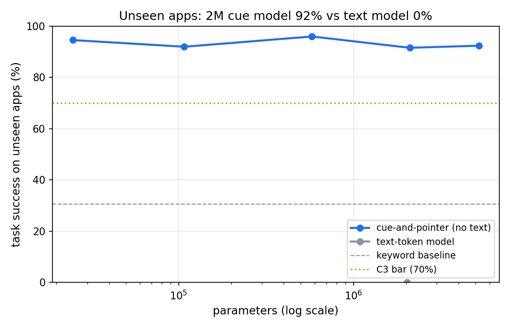

# 02 · Relative clauses: fixing long tasks for the pocket action model

**Goal:** fix [experiment 01](../01-pocket-actions)'s long-task failure (5%) by telling the model which part of the instruction it is on, store models in float16, and keep generalising to unseen apps.
**Verdict:** PASS (5/5 criteria). ✨ INTRIGUING: the smallest model (25K parameters, 62 KB at float16) completes 95% of tasks in apps it has never seen and 70% of tasks with 4-6 steps.
**Details:** [results](results/results.md) · [explainer](EXPLAINER.md) · [criteria](criteria.py)

| # | Criterion | Threshold | Result |
| --- | --- | --- | --- |
| C1 | Budget: kept models (float16), GPU training, eval RAM, CPU time per decision | ≤ 50 MB, ≤ 10 min, ≤ 2 GB, ≤ 10 ms | PASS: 27.3 MB, 3.9 min, 0.07 GB, 3.8 ms |
| C2 | In-distribution success (2M model, 3 seeds) | ≥ 90% | PASS: 91.1% ± 0.7% (01: 84.9%) |
| C3 | Success on unseen apps (core) | ≥ 70% and ≥ keyword + 25 pts | PASS: 91.6% ± 2.1% (keyword 30.6%; 01: 86.8%) |
| C4 | Success on tasks with twice the sub-goals | ≥ 60% | PASS: 64.5% ± 2.3% (01: 5.3%) |
| C5 | Cue model vs same-size text model, unseen apps | ≥ +15 pts | PASS: +91.6 pts (text model 0.0%) |
| NC | Negative control: the instruction swapped for another task's | must stay < 15% | 0.0%, as it should |

Same thresholds as 01, pre-registered before training.



## What I found

- **The clause signal is the fix.** Long tasks went from 5% to 64.5%. With every cue shown as "current" (the ablation), the same trained model drops to 0% on long tasks and 36% on short ones, so it relies on the signal.
- **Smaller is as good or better.** 25K parameters: 95% unseen, 70% long. 500K: 96% unseen, 80% long, the best of the sweep. The 2M and 5M models get too little training time to pull ahead.
- **float16 and int8 lose nothing.** All kept models total 27.3 MB at float16. The 2M model at int8 (2.2 MB) scores the same.
- **Not only the extra training time.** The 2M model after behavioural cloning alone (before DAgger) already reaches 64% on long tasks, against 5% for the full 01 model.
- **Still weak: new wording (26-31%).** The parser only knows "then" and "and", so "after that" and "next" merge everything into one clause, and the relative signal can't help. Teaching the parser joiners from data is the next step.
- The text rival still completes 0%. GPU training used 3.9 min. Fortran's RAM peaked at 94% because Obi's Shorts job was also running, and one training run was paused for 21 s without effect.

## What changed from 01

1. **Relative clause ids.** In 01, every cue word carried its clause number (0, 1, 2, ...). Training used at most 3 sub-goals, so the clause numbers in 4-6 sub-goal instructions were never seen. Now each word is tagged *finished*, *current*, *next* or *later*. The current clause is the first one not yet finished, and a clause finishes when the agent does its last action (paste, delete, send or toggle). Every long task looks like a short one from the model's point of view.
2. **Parser fix.** "and then" counted as two clause breaks in 01. It now counts as one.
3. **float16 checkpoints.** Half the size. 01 showed even int8 loses nothing.
4. **Longer training for the 2M models** (30 s each instead of 20 s, for C2), and one text-model seed instead of three (all three scored 0% in 01). Total planned training is about 3 minutes, plus DAgger rollouts.

The code is 01's, with the new behaviour behind switches that are off by default, so 01 still reproduces exactly. This folder only holds the settings, the criteria and the tests.

## Run it

```bash
python train.py --smoke   # 1-2 min end-to-end check (NVIDIA GPU)
python train.py           # full sweep, about 4 min of GPU training (hard cap 5.5), then GPU evaluation
python run.py             # PASS/FAIL table, plots, results/ (CPU, never trains)
python -m pytest -q
```
