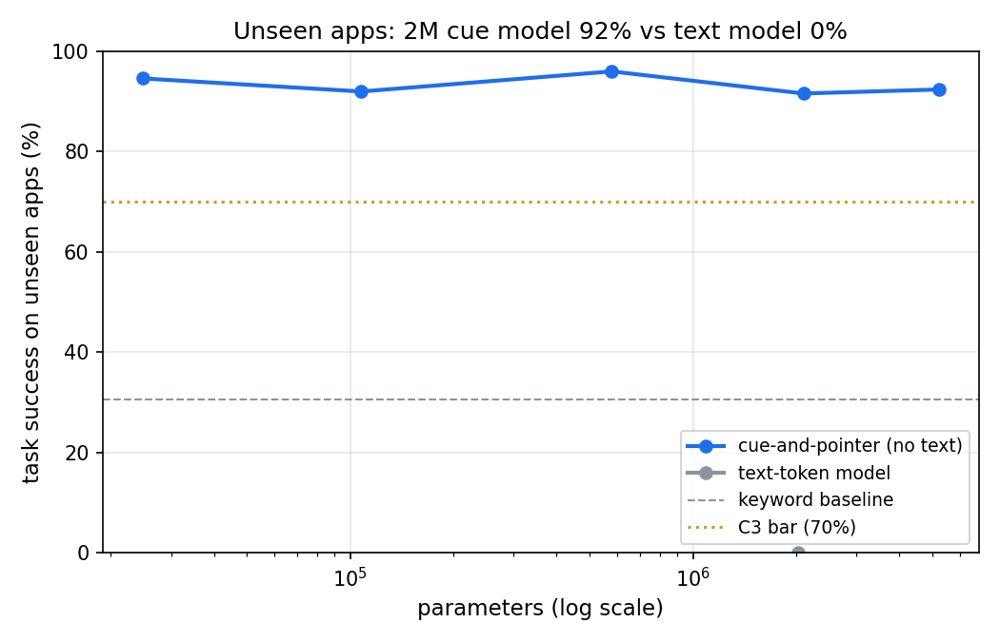
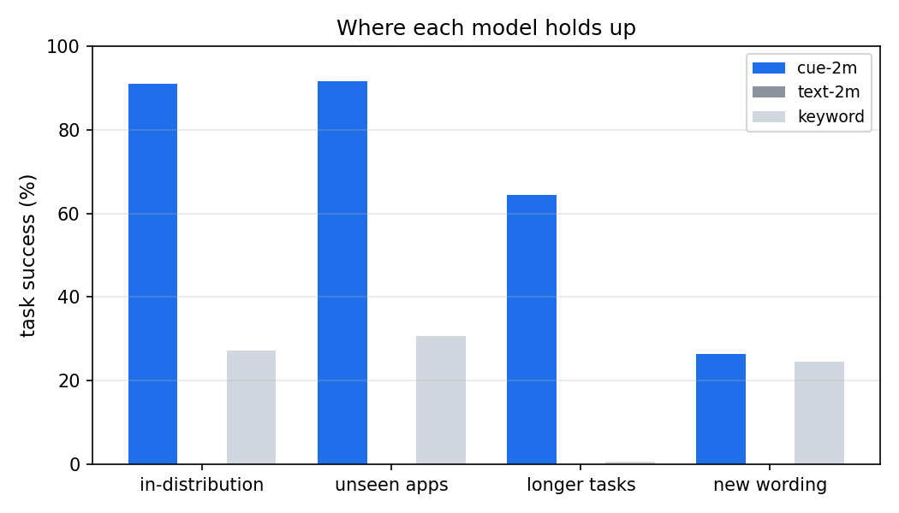

# Results: experiment 02 (relative clauses)

seed 0 · quick False · GPU NVIDIA GeForce RTX 4080 SUPER · torch 2.5.1+cu124 · 500 tasks per split · GPU training 3.92 min · python 3.12.10 · numpy 2.1.3 · peak RAM 0.07 GB · run.py 31 s

**Verdict: PASS** (5/5 criteria)

| # | Criterion | Value | Threshold | Result |
| --- | --- | --- | --- | --- |
| C1 | Budget: kept models, GPU training time, eval RAM, CPU ms/decision (5M model) | 27.3 MB, 3.9 min, 0.07 GB, 3.8 ms | <= 50 MB, <= 10 min, <= 2 GB, <= 10 ms | PASS |
| C2 | Learns the job: cue-2m success, in-distribution | 91.1% ± 0.7% | >= 90% | PASS |
| C3 | Generalises to unseen apps: cue-2m success | 91.6% ± 2.1% (keyword 30.6%) | >= 70% and >= keyword + 25 pts | PASS |
| C4 | Chains skills: cue-2m success, tasks with 2x the sub-goals | 64.5% ± 2.3% | >= 60% | PASS |
| C5 | No language needed: cue-2m minus text-2m, unseen apps | +91.6 pts (text 0.0% ± 0.0%) | >= +15 pts | PASS |
| NC | Negative control: cue-2m given another task's instruction, unseen apps | 0.0% | must stay < 15% | FAIL as expected |

## Task success by model and split (%)

| Model | in-distribution | unseen apps | longer tasks | new wording |
| --- | --- | --- | --- | --- |
| cue-20k | 91.6 | 94.6 | 70.2 | 22.2 |
| cue-100k | 90.2 | 92.0 | 67.4 | 28.0 |
| cue-500k | 96.8 | 96.0 | 79.8 | 26.0 |
| cue-2m-s0 | 91.8 | 92.6 | 64.0 | 30.6 |
| cue-2m-s1 | 91.0 | 89.2 | 62.4 | 25.8 |
| cue-2m-s2 | 90.4 | 93.0 | 67.0 | 22.4 |
| cue-5m | 90.2 | 92.4 | 64.6 | 25.0 |
| text-2m-s0 | 0.0 | 0.0 | 0.0 | 0.0 |
| keyword | 27.2 | 30.6 | 0.6 | 24.6 |
| random | 0.4 | 0.8 | 0.0 | 0.4 |
| control_blind_prompt | 0.0 | 0.0 | - | - |
| control_random_weights | 0.0 | 0.0 | - | - |
| perturb_int8_cue-2m-s0 | 91.6 | 92.6 | 65.0 | 30.6 |
| control_clause_blind | 36.2 | 36.2 | 0.0 | 31.8 |
| perturb_clutter_cue-2m-s0 | - | 86.6 | - | - |
| perturb_clutter_keyword | - | 29.2 | - | - |
| perturb_bconly_cue-2m-s0 | 89.6 | 91.6 | 63.8 | 27.6 |

## Training runs

| Run | Params | Steps | GPU seconds | Bytes |
| --- | --- | --- | --- | --- |
| cue-20k | 24,825 | 851 | 10.0 | 61,702 |
| cue-100k | 107,689 | 624 | 10.0 | 230,702 |
| cue-500k | 579,945 | 638 | 15.1 | 1,178,486 |
| cue-2m-s0 | 2,099,913 | 714 | 30.1 | 4,218,426 |
| cue-2m-s1 | 2,099,913 | 392 | 39.9 | 4,218,426 |
| cue-2m-s2 | 2,099,913 | 535 | 30.2 | 4,218,426 |
| cue-5m | 5,214,985 | 243 | 25.2 | 10,455,114 |
| text-2m-s0 | 2,026,498 | 407 | 30.2 | 4,068,066 |

